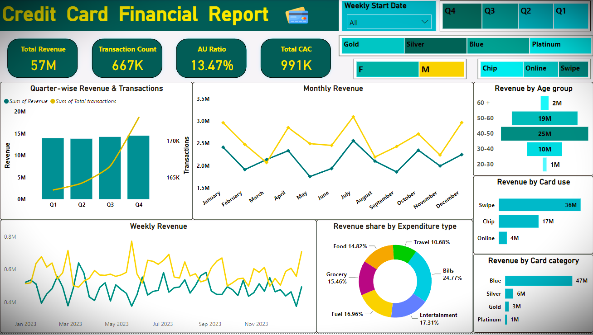
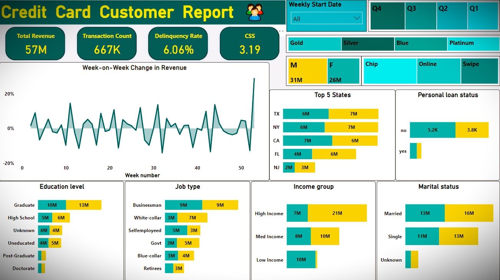
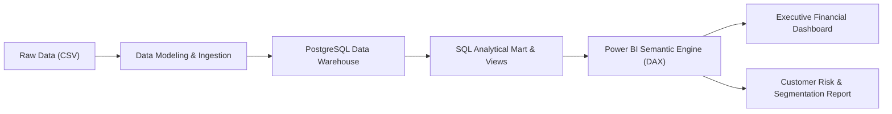

# 💳 Credit Card Financial & Customer Analytics Dashboard

[](https://www.postgresql.org/)
[](https://powerbi.microsoft.com/)
[](LICENSE)
[](https://github.com/nitesh28ku)

An end-to-end financial intelligence solution designed to ingest, process, and analyze weekly credit card transactions and customer behavioral patterns. By coupling a scalable SQL analytical data mart with interactive Power BI executive dashboards, this project delivers real-time visibility into revenue streams, customer segmentation, credit utilization, and credit delinquency risk.

---

## 📌 Executive Summary

Modern financial institutions require continuous monitoring of portfolio profitability, channel performance, and delinquency exposure. This project models and analyzes transaction and customer datasets spanning 53 operating weeks, transforming raw transactional records into actionable decision-making frameworks.

### 🌟 Key Performance Indicators (KPIs)
| Metric | Value | Business Interpretation |
| :--- | :--- | :--- |
| **Total Revenue** | **$57.0M** | Cumulative revenue generated from transactions, interest earned, and annual card fees. |
| **Total Transactions** | **667K** | Total recorded transaction volume across all payment categories. |
| **Avg. Card Utilization Ratio** | **13.47%** | Healthy portfolio revolving utilization indicating strong balance liquidity. |
| **Total Acquisition Cost (CAC)** | **$991K** | Marketing and origination spend across customer acquisition funnels. |
| **Portfolio Delinquency Rate** | **6.06%** | Share of accounts past-due or flagged as delinquent, requiring risk mitigation. |
| **Customer Satisfaction (CSS)** | **3.19 / 5.0** | Weighted customer satisfaction index across all active account tiers. |

---

## 📊 Dashboard Previews

### 1. Credit Card Financial Report
Focuses on financial performance, transaction methods, expenditure distributions, and revenue trends across quarters, months, and weeks.



### 2. Credit Card Customer Report
Focuses on demographic segmentation, week-over-week revenue trajectories, education, occupation, and portfolio risk.



---

## 🏗️ Technical Architecture & Pipeline



1. **Ingestion Layer**: Ingests baseline transaction (`credit_card.csv`) and demographic (`customer.csv`) tables along with weekly incremental updates (`cc_add.csv`, `cust_add.csv`).
2. **Data Warehouse (PostgreSQL)**: Enforces schema validation, referential integrity, and indexing on critical query predicates.
3. **Transformation & Analytical Mart**: Constructs reporting views (`vw_weekly_kpis`, `vw_customer_portfolio_summary`, `vw_delinquency_risk_monitor`) with window functions calculating Week-over-Week (WoW) revenue variance and rolling averages.
4. **Business Intelligence (Power BI)**: Delivers interactive dashboards with slicers by Quarter, Week, Card Category, and Channel.

---

## 📖 Data Dictionary

### `cc_detail` (Credit Card Activity Table)
| Field | Type | Description |
| :--- | :--- | :--- |
| `Client_Num` | INT | Unique client identification number. |
| `Card_Category` | VARCHAR(20) | Tier classification (`Blue`, `Silver`, `Gold`, `Platinum`). |
| `Annual_Fees` | INT | Annual subscription fee billed for the card tier. |
| `Activation_30_Days` | INT | Binary indicator (1/0) of card activation within 30 days of issuance. |
| `Customer_Acq_Cost` | INT | Acquisition spend incurred to onboard the cardholder. |
| `Week_Start_Date` | DATE | Weekly reporting cycle initiation date. |
| `Week_Num` | VARCHAR(20) | Fiscal week identifier (Week 1 through Week 53). |
| `Qtr` | VARCHAR(10) | Fiscal quarter (`Q1`, `Q2`, `Q3`, `Q4`). |
| `current_year` | INT | Fiscal operational year. |
| `Credit_Limit` | DECIMAL(10,2) | Total approved revolving credit limit ($). |
| `Total_Revolving_Bal` | INT | Unpaid balance carried over from month to month. |
| `Total_Trans_Amt` | INT | Cumulative dollar amount transacted. |
| `Total_Trans_Ct` | INT | Total count of transactions executed. |
| `Avg_Utilization_Ratio` | DECIMAL(10,3) | Proportion of credit limit actively utilized. |
| `Use_Chip` | VARCHAR(10) | Payment channel method (`Swipe`, `Chip`, `Online`). |
| `Exp_Type` | VARCHAR(50) | Spend category (`Bills`, `Entertainment`, `Fuel`, `Grocery`, `Food`, `Travel`). |
| `Interest_Earned` | DECIMAL(10,3) | Interest accrued on carried revolving balances. |
| `Delinquent_Acc` | VARCHAR(5) | Delinquency flag indicating account in default or past-due. |

### `cust_detail` (Customer Demographic Table)
| Field | Type | Description |
| :--- | :--- | :--- |
| `Client_Num` | INT | Foreign key linking to `cc_detail`. |
| `Customer_Age` | INT | Age of account holder in years. |
| `Gender` | VARCHAR(5) | Gender classification (`M`, `F`). |
| `Dependent_Count` | INT | Number of financial dependents. |
| `Education_Level` | VARCHAR(50) | Education level (`Graduate`, `High School`, `Post-Graduate`, etc.). |
| `Marital_Status` | VARCHAR(20) | Marital status (`Married`, `Single`, `Unknown`). |
| `State_cd` | VARCHAR(50) | State of residence (`TX`, `NY`, `CA`, `FL`, `NJ`, etc.). |
| `Zipcode` | VARCHAR(20) | Postal code of cardholder. |
| `Car_Owner` | VARCHAR(5) | Vehicle ownership flag (`yes`, `no`). |
| `House_Owner` | VARCHAR(5) | Home ownership flag (`yes`, `no`). |
| `Personal_Loan` | VARCHAR(5) | Active personal loan indicator (`yes`, `no`). |
| `Contact` | VARCHAR(50) | Preferred communication channel (`cellular`, `telephone`). |
| `Customer_Job` | VARCHAR(50) | Occupation category (`Businessman`, `White-collar`, `Govt`, etc.). |
| `Income` | INT | Annual documented customer income ($). |
| `Cust_Satisfaction_Score`| INT | Rating score provided by client (1 to 5). |

---

## 💡 Key Business Insights

1. **Card Tier Dominance**: 
   - The **Blue Card** tier is the bedrock of portfolio revenue, generating **$47M (82.5%)** of total revenue.
   - High-end tiers (**Silver: $6M, Gold: $3M, Platinum: $1M**) capture smaller customer footprints but carry higher average transaction values.
2. **Demographic Revenue Drivers**:
   - The **40–50 age bracket** represents the most lucrative cohort, generating **$25M (43.8%)**, followed by **50–60 ($19M)**.
   - Male customers generated **$31M**, while female customers contributed **$26M**.
3. **Expenditure Dynamics**:
   - Everyday household necessities and utilities drive top revenue: **Bills (24.77%)**, **Entertainment (17.31%)**, **Fuel (16.96%)**, and **Grocery (15.46%)**.
   - Discretionary travel accounts for **10.68%** of total card spend.
4. **Channel Preference**:
   - In-store **Swipe** payments account for **$36M**, followed by **Chip** transactions at **$17M**.
   - **Online** checkout volume stands at **$4M**, representing an untapped growth opportunity for targeted digital-wallet incentives.
5. **Geographic Concentration**:
   - Three key states—**Texas ($13M)**, **New York ($13M)**, and **California ($13M)**—account for **68.4%** of aggregate state revenue, with Florida contributing **$10M**.
6. **Delinquency & Risk Assessment**:
   - Portfolio delinquency stands at **6.06%**. Delinquency is heavily correlated with higher revolving balances in low-to-medium income segments.

---

## 🛠️ Project Structure

```text
Credit_Card_Analysis/
├── assets/
│   ├── Dashboard-1.png          # High-resolution Financial Report preview
│   └── Dashboard-2.png          # High-resolution Customer Report preview
├── sql/
│   ├── 01_schema_and_import.sql # DDL scripts and CSV ingestion pipeline
│   ├── 02_core_analytical_queries.sql # KPI & segmentation business queries
│   └── 03_reporting_views.sql   # Performance indexes & Power BI staging views
├── credit_card_sql.sql          # Master consolidated SQL script
├── credit_card.csv              # Primary transaction dataset
├── customer.csv                 # Primary demographic dataset
├── cc_add.csv                   # Week 53 incremental transaction update
├── cust_add.csv                 # Week 53 incremental customer update
├── Dashboard-1.png              # Root financial dashboard preview
├── Dashboard-2.png              # Root customer dashboard preview
├── .gitignore                   # Production repository ignore rules
└── README.md                    # Project documentation & execution guide
```

---

## 🚀 Setup & Execution Guide

### 1. Database Initialization (PostgreSQL)
Ensure PostgreSQL 12+ is installed and accessible via `psql`:

```bash
# Clone the repository
git clone https://github.com/nitesh28ku/Credit_Card_Analysis.git
cd Credit_Card_Analysis

# Create target database
createdb credit_card_db

# Execute the consolidated schema and ingestion pipeline
psql -d credit_card_db -f credit_card_sql.sql
```

### 2. Analytical Queries & Views Verification
Run the analytical queries to verify portfolio KPIs:

```bash
psql -d credit_card_db -f sql/02_core_analytical_queries.sql
```

### 3. Power BI Configuration
1. Open **Power BI Desktop**.
2. Select **Get Data** > **PostgreSQL database**.
3. Server: `localhost` | Database: `credit_card_db`.
4. Import tables: `vw_customer_portfolio_summary` and `vw_weekly_kpis`.
5. Apply DAX measures for custom metrics:
   ```dax
   Total_Revenue = SUM(cc_detail[Total_Trans_Amt]) + SUM(cc_detail[Interest_Earned]) + SUM(cc_detail[Annual_Fees])
   Delinquency_Rate = DIVIDE(CALCULATE(COUNT(cc_detail[Client_Num]), cc_detail[Delinquent_Acc] = "1"), COUNT(cc_detail[Client_Num]), 0)
   ```

---

## 👤 Author

**Nitesh Kumar**
- **GitHub**: [@nitesh28ku](https://github.com/nitesh28ku)
- **Email**: [niteshkumar190904@gmail.com](mailto:niteshkumar190904@gmail.com)

---

## 📄 License
This project is licensed under the [MIT License](LICENSE) - feel free to use and adapt it for learning or portfolio demonstration.
